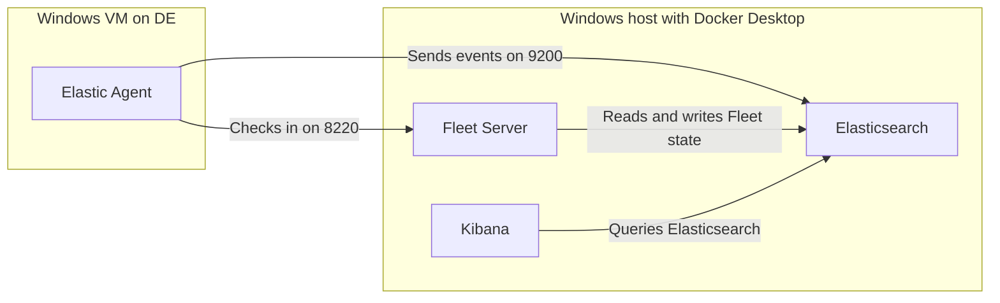
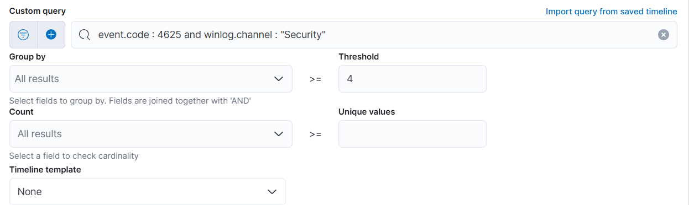
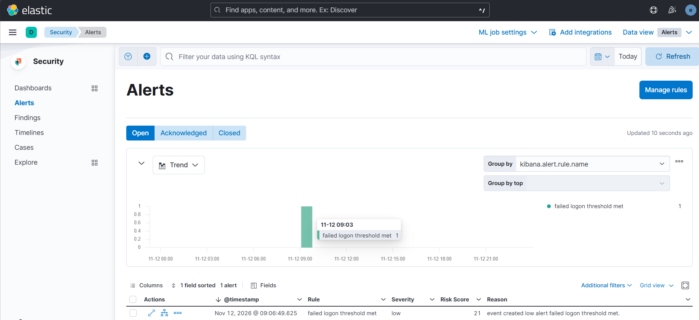

# Threat Detection Engineering Lab

A Windows endpoint lab for collecting security events in Elastic, writing detection rules, and testing them against controlled activity. Elasticsearch and Kibana run in Docker Desktop on a Windows host. A Windows VM on a VMware host-only network serves as the test endpoint.

## Current status

- [x] Start Elasticsearch and Kibana on Docker Desktop.
- [x] Open Kibana from the Windows VM over the DE host-only network.
- [x] Start Fleet Server and enroll the Windows VM with Elastic Agent.
- [x] Confirm Windows Security events in Kibana Discover.
- [x] Validate a failed-logon rule and document the resulting alert.

## Lab architecture

The VMware network is named `net5-DE`. It uses host adapter `VMnet5` and subnet `192.168.50.0/24`. The diagram shows the intended flow once the agent is enrolled.



| Path | Purpose |
| --- | --- |
| `esk/` | Docker Compose configuration for Elasticsearch and Kibana. |
| `fleet/` | Docker Compose configuration for Fleet Server. |
| `certs/` | Local directory for lab TLS certificates and keys. |

## Setup

### Start Elasticsearch and Kibana

1. Start Docker Desktop with Linux containers. Connect the Windows VM to the DE host-only network and give the VM and the host's VMware adapter distinct IPv4 addresses on that subnet.
2. For a fresh checkout, create `certs/` at the repository root. Use `esk/.env.example` and `fleet/.env.example` to create a local `.env` in each directory. Set your own passwords and keys. Fill in the Fleet service token after generating the policy.
3. Run these commands in PowerShell from the repository root.

```powershell
Push-Location .\esk
docker compose up -d
docker compose ps
Pop-Location
```

Open Kibana on port `5601`. On the desktop, use `localhost`. From the VM, use the desktop's DE IPv4 address and the same HTTP or HTTPS scheme.

### Set up Fleet and the endpoint

1. In Kibana, open **Management → Fleet → Add Fleet Server**. Use `https://<DE_HOST_IP>:8220` for the Fleet Server host, substituting the desktop's DE IPv4 address.
2. Generate the Fleet Server policy. Copy the service token from the generated command into the matching setting in `fleet/.env`.
3. Start Fleet Server from the repository root.

```powershell
Push-Location .\fleet
docker compose up -d
docker compose ps
Pop-Location
```

Once Fleet Server is connected, configure the Elasticsearch output for the lab at `https://<DE_HOST_IP>:9200` using the lab's TLS settings. In Fleet, use **Add Agent** to enroll the Windows VM under a policy that collects Windows Security events. Verify that the agent is healthy and that events from the VM appear in **Discover**.

## Troubleshooting the DE connection

During setup, the desktop's VMnet5 adapter showed a `169.254.x.x` address while DE was configured for `192.168.50.0/24`. Check the IPv4 addresses on both machines. Use an available address on DE for the desktop's VMnet5 adapter, then use that address to reach the desktop from the VM.

Run this from PowerShell **inside the VM**. Replace `192.168.50.1` with the desktop's actual DE address.

```powershell
Test-NetConnection 192.168.50.1 -Port 5601
```

A result of `TcpTestSucceeded : True` confirms the VM can reach Kibana's TCP port.

## Planned detection tests

- **Failed Windows logons.** Use the book's threshold rule to verify that Windows Security events reach Elastic and generate an alert.
- **Encoded PowerShell.** Use Sysmon process creation events to test a custom rule for `-EncodedCommand`. Compare a harmless encoded invocation with a normal PowerShell launch. Record the rule logic, test results, and likely false positives such as legitimate administrative scripts.

### Filed Logon Windows Detection

The rule matches windows event id 4626 which logs failed logon attempts, a threshold of 4 failed attempts.


### Validation

I attempted to trigger the rule by entering the wrong logon credentials to meet the threshold on the monitored host, The rule produced an alert in Elastic.



## Credits

The base Compose setup follows Chapter 3 of *Practical Threat Detection Engineering* by Megan Roddie, Jason Deyalsingh, and Gary J. Katz. [Packt companion repository](https://github.com/PacktPublishing/Practical-Threat-Detection-Engineering) · [Upstream MIT license](https://github.com/PacktPublishing/Practical-Threat-Detection-Engineering/blob/main/LICENSE)